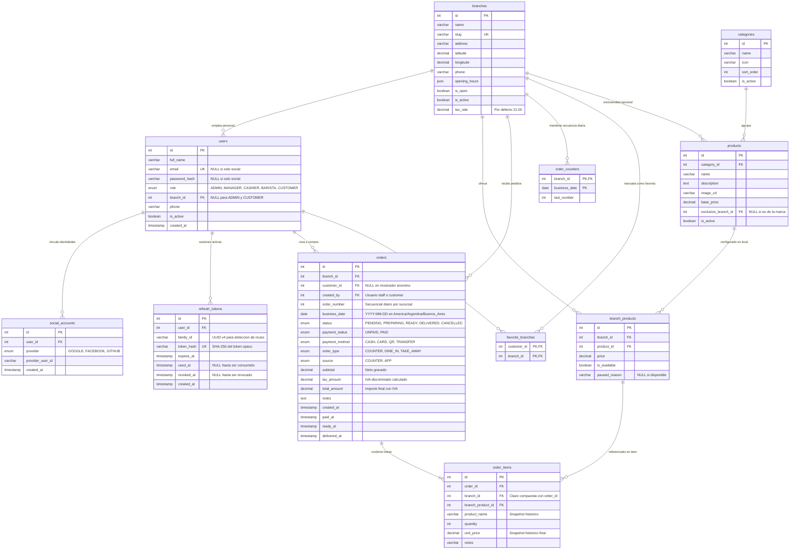
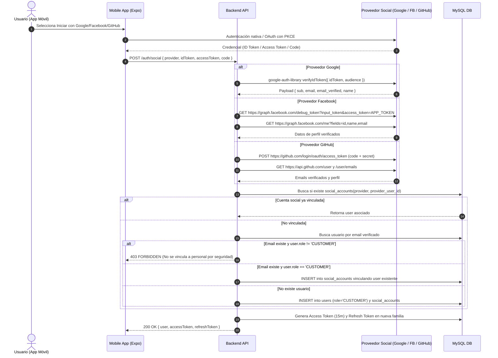

# ARCHITECTURE.md - LateSoft Cafeterías (Argentina)
Sistema de Gestión y Pedidos Multi-Sucursal para Cadena de Cafeterías

Este documento define la arquitectura integral, el modelo de datos relacional, el contrato exhaustivo de la API RESTful, la matriz de seguridad basada en roles (RBAC) con aislamiento por sucursal (tenant isolation), los flujos criptográficos de autenticación, la estructura del proyecto y el plan de verificación de calidad.

---

## 1. Modelo de Datos MySQL

### 1.1 Diagrama de Entidad-Relación (Mermaid)



### 1.2 Restricciones de Integridad y Reglas de Base de Datos

1. **Claves Primarias y Foráneas:**
   - Todas las tablas operan bajo el motor `InnoDB` con juego de caracteres `utf8mb4` y colación `utf8mb4_unicode_ci`.
   - `order_items` cuenta con clave foránea compuesta `(order_id, branch_id) REFERENCES orders(id, branch_id)` para asegurar que ningún ítem pertenezca a una sucursal distinta a la de su cabecera.
   - `social_accounts.user_id` `ON DELETE CASCADE`.
   - `refresh_tokens.user_id` `ON DELETE CASCADE`.
   - `favorite_branches.customer_id` `ON DELETE CASCADE`.
   - Tablas con valor histórico o transaccional (`orders`, `branch_products`) restringen la eliminación (`RESTRICT`) o utilizan baja lógica mediante `is_active = FALSE`.

2. **Unicidades (UNIQUE Constraints):**
   - `users.email`: Único cuando no es nulo (`UNIQUE KEY uk_users_email (email)`).
   - `social_accounts(provider, provider_user_id)`: Unicidad por proveedor social.
   - `refresh_tokens.token_hash`: Hash SHA-256 único en la tabla.
   - `branches.slug`: Slug alfanumérico amigable único para búsqueda y escaneo de códigos QR.
   - `branch_products(branch_id, product_id)`: Un producto solo puede configurarse una vez por sucursal.
   - `orders(branch_id, business_date, order_number)`: Garantiza que no existan números de comanda duplicados para un mismo día y sucursal.
   - `order_counters(branch_id, business_date)`: Clave primaria compuesta para bloqueo de fila (`SELECT ... FOR UPDATE`).
   - `favorite_branches(customer_id, branch_id)`: Clave primaria compuesta.

3. **Restricciones CHECK:**
   - `chk_user_role_branch`:
     ```sql
     CHECK (
       (role IN ('MANAGER', 'CASHIER', 'BARISTA') AND branch_id IS NOT NULL) OR
       (role IN ('ADMIN', 'CUSTOMER') AND branch_id IS NULL)
     )
     ```
   - `chk_user_identity`:
     ```sql
     CHECK (email IS NOT NULL OR password_hash IS NULL)
     ```
     (Un usuario debe tener email o autenticarse mediante cuenta social asociada en `social_accounts`).
   - `chk_positive_amounts`:
     ```sql
     CHECK (subtotal >= 0 AND tax_amount >= 0 AND total_amount >= 0)
     ```

4. **Reglas de Redondeo y Moneda Argentina:**
   - Todos los importes monetarios se definen como `DECIMAL(12,2)`.
   - Los precios en el sistema son finales con IVA incluido.
   - El IVA se calcula por línea de producto o sobre el total de la orden según la alícuota configurada en la sucursal (`branches.tax_rate`, por defecto `21.00` %):
     $$\text{neto} = \text{round}\left(\frac{\text{total}}{1 + \frac{\text{tax\_rate}}{100}}, 2\right)$$
     $$\text{iva} = \text{total} - \text{neto}$$
   - Ejemplo: Producto a $\$121{,}00$ con tasa $21\% \implies \text{neto} = \$100{,}00$, $\text{iva} = \$21{,}00$. Si `tax_rate = 0.00`, $\text{neto} = \$121{,}00$ e $\text{iva} = \$0{,}00$.

5. **Trigger de Exclusividad de Sucursal:**
   - Un trigger en `branch_products` (`trg_check_branch_product_exclusive`) valida al insertar o actualizar que si `products.exclusive_branch_id` no es nulo, debe coincidir estrictamente con el `branch_id` asignado en `branch_products`.

---

## 2. Contrato Exhaustivo de la API RESTful

Formato unificado de error:
```json
{
  "error": {
    "code": "VALIDATION_ERROR | UNAUTHORIZED | FORBIDDEN | NOT_FOUND | CONFLICT | UNPROCESSABLE_ENTITY | TOO_MANY_REQUESTS | INTERNAL_SERVER_ERROR",
    "message": "Mensaje legible en español (voseo)",
    "details": []
  }
}
```

| Método | Endpoint | Roles Permitidos | Parámetros / Query | Cuerpo (Request Body) | Respuesta Exitosa (200/201) | Códigos de Error |
| :--- | :--- | :--- | :--- | :--- | :--- | :--- |
| `POST` | `/auth/register` | Público | Ninguno | `{ fullName, email, password, phone? }` | `{ user, accessToken, refreshToken }` (201) | 400, 409 |
| `POST` | `/auth/login` | Público | Ninguno | `{ email, password }` | `{ user, accessToken, refreshToken }` (200) | 400, 401 |
| `POST` | `/auth/social` | Público | Ninguno | `{ provider: "GOOGLE"\|"FACEBOOK"\|"GITHUB", idToken?, accessToken?, code?, redirectUri? }` | `{ user, accessToken, refreshToken }` (200) | 400, 401, 403 |
| `POST` | `/auth/refresh` | Público | Ninguno | `{ refreshToken }` | `{ accessToken, refreshToken }` (200) | 400, 401 |
| `POST` | `/auth/logout` | Autenticado | Ninguno | `{ refreshToken }` | `{ message: "Sesión cerrada correctamente" }` (200) | 400, 401 |
| `GET` | `/auth/me` | Autenticado | Ninguno | Ninguno | `{ user }` (200) | 401 |
| `PATCH` | `/users/me` | Autenticado | Ninguno | `{ fullName?, phone? }` | `{ user }` (200) | 400, 401 |
| `GET` | `/users` | ADMIN, MANAGER | `page`, `limit`, `role`, `search` | Ninguno | `{ data: User[], meta: PaginationMeta }` (200) | 401, 403 |
| `POST` | `/users` | ADMIN, MANAGER | Ninguno | `{ fullName, email, password, role, branchId?, phone? }` | `{ user }` (201) | 400, 403, 409 |
| `GET` | `/users/:id` | ADMIN, MANAGER | `id` (int) | Ninguno | `{ user }` (200) | 401, 403, 404 |
| `PUT` | `/users/:id` | ADMIN, MANAGER | `id` (int) | `{ fullName?, phone?, isActive?, branchId? }` | `{ user }` (200) | 400, 403, 404 |
| `DELETE` | `/users/:id` | ADMIN, MANAGER | `id` (int) | Ninguno | `{ message: "Usuario desactivado" }` (200) | 401, 403, 404 |
| `GET` | `/branches` | Público | `activeOnly` (default true) | Ninguno | `{ data: Branch[] }` (200) | 500 |
| `GET` | `/branches/:id` | Público | `id` (int o slug) | Ninguno | `{ branch: Branch }` (200) | 404 |
| `POST` | `/branches` | ADMIN | Ninguno | `{ name, slug, address, latitude, longitude, phone, openingHours, taxRate }` | `{ branch }` (201) | 400, 401, 403, 409 |
| `PUT` | `/branches/:id` | ADMIN | `id` (int) | `{ name?, address?, latitude?, longitude?, phone?, openingHours?, isOpen?, isActive?, taxRate? }` | `{ branch }` (200) | 400, 401, 403, 404 |
| `DELETE` | `/branches/:id` | ADMIN | `id` (int) | Ninguno | `{ message: "Sucursal desactivada" }` (200) | 401, 403, 404 |
| `GET` | `/categories` | Público | Ninguno | Ninguno | `{ data: Category[] }` (200) | 500 |
| `POST` | `/categories` | ADMIN | Ninguno | `{ name, icon, sortOrder }` | `{ category }` (201) | 400, 401, 403 |
| `PUT` | `/categories/:id` | ADMIN | `id` (int) | `{ name?, icon?, sortOrder?, isActive? }` | `{ category }` (200) | 400, 401, 403, 404 |
| `DELETE` | `/categories/:id`| ADMIN | `id` (int) | Ninguno | `{ message: "Categoría desactivada" }` (200) | 401, 403, 404 |
| `GET` | `/products` | Público | `categoryId`, `search`, `page`, `limit` | Ninguno | `{ data: Product[], meta }` (200) | 500 |
| `POST` | `/products` | ADMIN | Ninguno | `{ categoryId, name, description, imageUrl, basePrice, exclusiveBranchId? }` | `{ product }` (201) | 400, 401, 403 |
| `PUT` | `/products/:id` | ADMIN | `id` (int) | `{ categoryId?, name?, description?, imageUrl?, basePrice?, exclusiveBranchId?, isActive? }` | `{ product }` (200) | 400, 401, 403, 404 |
| `DELETE` | `/products/:id` | ADMIN | `id` (int) | Ninguno | `{ message: "Producto desactivado" }` (200) | 401, 403, 404 |
| `GET` | `/branches/:id/menu` | Público | `id` (int) | Ninguno | `{ branch, menu: CategoryWithItems[] }` (200) | 404 |
| `POST` | `/branches/:id/menu/:productId` | MANAGER, ADMIN | `id`, `productId` | `{ price?, isAvailable? }` | `{ branchProduct }` (201) | 400, 403, 404, 409 |
| `PUT` | `/branches/:id/menu/:productId` | MANAGER, ADMIN | `id`, `productId` | `{ price?, isAvailable? }` | `{ branchProduct }` (200) | 400, 403, 404 |
| `DELETE` | `/branches/:id/menu/:productId` | MANAGER, ADMIN | `id`, `productId` | Ninguno | `{ message: "Producto retirado de la sucursal" }` (200) | 403, 404 |
| `PATCH` | `/branches/:id/menu/:productId/availability` | BARISTA, MANAGER, ADMIN | `id`, `productId` | `{ isAvailable: boolean, pausedReason?: string }` | `{ branchProduct }` (200) | 400, 403, 404 |
| `GET` | `/me/favorite-branches` | CUSTOMER | Ninguno | Ninguno | `{ data: Branch[] }` (200) | 401 |
| `POST` | `/me/favorite-branches` | CUSTOMER | Ninguno | `{ branchId: number }` | `{ message: "Sucursal agregada a favoritas" }` (201) | 400, 401, 404 |
| `DELETE` | `/me/favorite-branches/:branchId` | CUSTOMER | `branchId` | Ninguno | `{ message: "Sucursal eliminada de favoritas" }` (200) | 401, 404 |
| `POST` | `/orders` | CUSTOMER, CASHIER, ADMIN | Ninguno | `{ branchId, orderType, notes?, items: [{ branchProductId, quantity, notes? }] }` | `{ order }` (201) | 400, 401, 404, 422 |
| `GET` | `/orders` | Autenticado | `page`, `limit`, `status`, `date` | Ninguno | `{ data: Order[], meta }` (200) | 401 |
| `GET` | `/orders/:id` | Autenticado | `id` (int) | Ninguno | `{ order: OrderWithItems }` (200) | 401, 403, 404 |
| `PATCH` | `/orders/:id/status` | Staff, ADMIN | `id` (int) | `{ status: "PREPARING"\|"READY"\|"DELIVERED"\|"CANCELLED", cancelReason? }` | `{ order }` (200) | 400, 401, 403, 404, 422 |
| `POST` | `/orders/:id/pay` | CASHIER, ADMIN | `id` (int) | `{ paymentMethod: "CASH"\|"CARD"\|"QR"\|"TRANSFER" }` | `{ order }` (200) | 400, 401, 403, 404, 422 |
| `GET` | `/orders/kds` | BARISTA, MANAGER, ADMIN | `branchId?` (solo ADMIN) | Ninguno | `{ data: OrderKDS[] }` (200) | 401, 403 |
| `GET` | `/reports/sales` | MANAGER, ADMIN | `branchId?`, `from`, `to` | Ninguno | `{ summary, salesByDate, paymentBreakdown }` (200) | 400, 401, 403 |
| `GET` | `/reports/top-products` | MANAGER, ADMIN | `branchId?`, `from`, `to`, `limit` | Ninguno | `{ data: TopProductItem[] }` (200) | 400, 401, 403 |

---

## 3. Matriz de Permisos por Recurso y Rol (RBAC & Tenant Isolation)

| Recurso / Operación | CUSTOMER | CASHIER | BARISTA | MANAGER | ADMIN | Regla de Aislamiento de Sucursal (Tenant Scope) |
| :--- | :---: | :---: | :---: | :---: | :---: | :--- |
| **Sucursales (Leer)** | Sí | Sí | Sí | Sí | Sí | Público. Solo activas excepto ADMIN. |
| **Sucursales (ABM)** | No | No | No | No | Sí | Exclusivo ADMIN global. |
| **Categorías y Catálogo** | Lectura | Lectura | Lectura | Lectura | CRUD | Modificaciones exclusivas de ADMIN. |
| **Menú de Sucursal (Precios/Alta)** | No | No | No | Sí | Sí | MANAGER solo su `req.user.branchId`. ADMIN cualquiera. |
| **Pausar Producto (KDS)** | No | No | Sí | Sí | Sí | BARISTA/MANAGER solo en su `req.user.branchId`. |
| **Crear Usuario Staff** | No | No | No | Sí | Sí | MANAGER solo roles CASHIER/BARISTA en su `branchId`. ADMIN crea cualquier rol (incluidos MANAGER). |
| **Crear Pedido (App)** | Sí | No | No | No | No | Pedido nace en `PENDING` y `UNPAID`. |
| **Crear Pedido (POS)** | No | Sí | No | No | Sí | CASHIER crea en su `branchId`, nace `PAID` y `COUNTER`. |
| **Ver Pedidos (Listado)** | Propios | De su local | De su local | De su local | Global | CUSTOMER filtra por `customer_id = req.user.id`. Staff filtra estrictamente por `branch_id = req.user.branchId`. |
| **Cobrar Pedido (`/pay`)** | No | Sí | No | No | Sí | CASHIER solo de su `branchId`. Valida estado `UNPAID`. |
| **Avanzar Estado en KDS** | No | No | Sí | Sí | Sí | BARISTA/MANAGER solo pedidos `PAID` de su local. Transiciones: `PENDING -> PREPARING -> READY -> DELIVERED`. |
| **Cancelar Pedido** | No | No | No | Sí | Sí | MANAGER solo pedidos no entregados de su local. ADMIN global. |
| **Reportes de Ventas** | No | No | No | Sí | Sí | MANAGER forzado a su `branchId`. ADMIN puede consolidar o filtrar por sucursal. |

---

## 4. Flujo Criptográfico de Autenticación y Ciclo de Vida de Tokens

### 4.1 Registro y Login Tradicional
1. **Contraseñas**: Hasheadas con `bcrypt` (costo = 12). Nunca se persisten en texto plano ni se exponen en logs.
2. **Access Token (JWT)**:
   - Firmado con secreto asimétrico o HMAC-SHA256 (`JWT_ACCESS_SECRET`).
   - Tiempo de expiración: 15 minutos (`15m`).
   - Carga útil (*claims*): `{ sub: user.id, role: user.role, branchId: user.branch_id }`.
3. **Refresh Token**:
   - Cadena opaca criptográficamente aleatoria (`crypto.randomBytes(40).toString('hex')`).
   - Tiempo de vida: 7 días (`7d`).
   - Se guarda en base de datos **únicamente el hash SHA-256** del token (`crypto.createHash('sha256').update(token).digest('hex')`).
   - Asociado a un `family_id` (UUID v4) que agrupa la cadena de rotación.

### 4.2 Verificación en Servidor de Login Social (Google, Facebook, GitHub)
La aplicación móvil obtiene credenciales y las envía a `POST /auth/social`. **El servidor valida directamente contra el proveedor:**



### 4.3 Rotación de Refresh Token y Detección de Reutilización
- Cada llamada a `POST /auth/refresh` con un token válido marca el token actual como `used_at = NOW()` y emite un nuevo refresh token manteniendo el mismo `family_id`.
- **Detección de Reutilización**: Si llega una petición con un token que ya tiene `used_at IS NOT NULL`, se detecta un posible compromiso o ataque de repetición. Inmediatamente el backend ejecuta:
  ```sql
  UPDATE refresh_tokens SET revoked_at = NOW() WHERE family_id = ?;
  ```
  Esto invalida todas las sesiones de esa familia y fuerza a reautenticarse.

---

## 5. Estructura del Repositorio y Variables de Entorno

### 5.1 Estructura de Carpetas

```
LATESOFT/
├── ARCHITECTURE.md
├── README.md
├── docs/
│   ├── GUIA_INSTALACION.md
│   └── MANUAL_USUARIO.md
├── backend/
│   ├── .env.example
│   ├── package.json
│   ├── tsconfig.json
│   ├── knexfile.ts
│   ├── src/
│   │   ├── config/             # Variables de entorno validadas con zod
│   │   ├── db/
│   │   │   ├── connection.ts   # Pool de conexiones Knex
│   │   │   ├── migrations/     # Migraciones estructuradas
│   │   │   └── seeds/          # Seeds con datos reales de sucursales argentinas
│   │   ├── middlewares/        # auth, error handler, rate limit, rbac
│   │   ├── modules/
│   │   │   ├── auth/           # Registro, login, refresh, social
│   │   │   ├── branches/       # ABM sucursales y menú local
│   │   │   ├── categories/     # Categorías
│   │   │   ├── products/       # Catálogo maestro
│   │   │   ├── orders/         # Creación, transiciones, transacciones comanda
│   │   │   ├── reports/        # Ventas y métricas
│   │   │   └── users/          # Personal y clientes
│   │   ├── utils/              # Calculador de IVA, logger, generador de tokens
│   │   ├── app.ts              # Express app configurada
│   │   └── server.ts           # Entrada del servidor
│   └── tests/                  # Tests Jest y Supertest
└── mobile/
    ├── app.json
    ├── eas.json
    ├── package.json
    ├── tsconfig.json
    ├── .env.example
    ├── app/                    # Expo Router
    │   ├── _layout.tsx         # Root layout con Context Providers y guardias
    │   ├── index.tsx           # Entry point con redirección por rol
    │   ├── (auth)/             # Login, registro, social buttons
    │   ├── (customer)/         # Selector sucursal, Home, Menú, Carrito, Pedidos, Perfil
    │   ├── (staff)/            # POS (cajero), KDS (barista), Gestión/Reportes (manager)
    │   └── (admin)/            # ABM Sucursales, Catálogo, Encargados, Dashboard global
    └── src/
        ├── api/                # Cliente Axios con interceptor single-flight refresh
        ├── context/            # AuthContext, BranchContext, CartContext
        ├── hooks/              # useAuth, useBranch, useCart
        ├── components/         # Button, Input, Card, ErrorBanner, EmptyState, Screen
        └── utils/              # Formateadores de moneda es-AR, cálculos Haversine
```

### 5.2 Matriz de Variables de Entorno

| Variable | Ámbito | Pública / Secreta | Descripción |
| :--- | :--- | :--- | :--- |
| `PORT` | Backend | Secreta | Puerto HTTP del servidor (ej. `3001`) |
| `NODE_ENV` | Backend | Secreta | `development` \| `production` \| `test` |
| `DB_CLIENT` | Backend | Secreta | `mysql2` (o `better-sqlite3`/`sqlite3` para tests) |
| `DB_HOST` | Backend | Secreta | Servidor de base de datos MySQL |
| `DB_PORT` | Backend | Secreta | Puerto de conexión MySQL (3306) |
| `DB_USER` | Backend | Secreta | Usuario de MySQL |
| `DB_PASSWORD` | Backend | Secreta | Contraseña de MySQL |
| `DB_NAME` | Backend | Secreta | Nombre de base de datos |
| `JWT_ACCESS_SECRET` | Backend | Secreta | Clave para firmar Access Tokens |
| `JWT_ACCESS_EXPIRES_IN` | Backend | Secreta | Duración de Access Token (ej. `15m`) |
| `REFRESH_TOKEN_EXPIRES_DAYS` | Backend | Secreta | Días de vigencia del Refresh Token (ej. `7`) |
| `GOOGLE_CLIENT_IDS` | Backend | Secreta | Lista de Web y Android Client IDs separados por coma |
| `FACEBOOK_APP_ID` | Backend | Secreta | ID de la App en Meta for Developers |
| `FACEBOOK_APP_SECRET`| Backend | Secreta | App Secret de Meta para debug_token |
| `GITHUB_CLIENT_ID` | Backend | Secreta | Client ID de la OAuth App de GitHub |
| `GITHUB_CLIENT_SECRET`| Backend | Secreta | Client Secret para intercambio del code |
| `EXPO_PUBLIC_API_URL` | Mobile | Pública | URL base del backend accesible desde el dispositivo |
| `EXPO_PUBLIC_GOOGLE_WEB_CLIENT_ID` | Mobile | Pública | Client ID Web para Google Sign-In SDK |
| `EXPO_PUBLIC_GOOGLE_ANDROID_CLIENT_ID` | Mobile | Pública | Client ID Android para Google Sign-In |
| `EXPO_PUBLIC_FACEBOOK_APP_ID` | Mobile | Pública | ID de App de Facebook en el cliente |
| `EXPO_PUBLIC_GITHUB_CLIENT_ID` | Mobile | Pública | Client ID de GitHub para flujo de autorización |
| `EXPO_PUBLIC_ENABLE_DEV_SWITCHER` | Mobile | Pública | `true` para barra de cambio rápido de usuarios en desarrollo |

---

## 6. Plan de Pruebas Automatizadas

1. **Autenticación y Seguridad:**
   - Registro de usuario cliente ignorando cualquier rol en el cuerpo (siempre crea `CUSTOMER`).
   - Login con credenciales válidas y fallo con contraseña inválida.
   - Rechazo de petición con token expirado.
   - Renovación con rotación de refresh token y emisión de nuevo par.
   - **Prueba de Reutilización:** Intento de usar un refresh token ya consumido produce revocación inmediata de la familia y respuesta 401.
   - Logout invalida el refresh token.
   - Login social simulado: enlace automático de cuenta cliente; rechazo estricto si el email coincide con un usuario de rol staff/admin.

2. **Permisos y Control de Acceso (RBAC & IDOR):**
   - Un usuario con rol `CUSTOMER` no puede acceder a endpoints de staff (`403 Forbidden`).
   - Un `CASHIER` no puede acceder a funciones de `MANAGER` ni `ADMIN`.
   - **Aislamiento Multitenant (IDOR):** Un `MANAGER` de la Sucursal 1 intenta consultar, modificar o cancelar un pedido de la Sucursal 2 $\implies$ Retorna `403 Forbidden` o `404 Not Found`.

3. **Cálculo de Impuestos y Totales (Moneda Argentina):**
   - Validación del cálculo en backend: Ítem con valor $\$121{,}00$ y alícuota $21\%$ calcula exactamente $\$21{,}00$ de IVA y $\$100{,}00$ de neto.
   - Manipulación de precios: si el cliente envía montos adulterados en el cuerpo de la orden, el backend los descarta y toma estrictamente los valores de la base de datos.

4. **Concurrencia en Numeración de Pedidos:**
   - Dos órdenes creadas concurrentemente para la misma sucursal y fecha obtienen números consecutivos sin colisión gracias a la transacción con bloqueo de fila en `order_counters`.

---

## 7. Decisiones de Arquitectura y Supuestos

1. **Gestión de Fechas y Zona Horaria:** Toda fecha comercial de numeración y reportes se computa en `America/Argentina/Buenos_Aires` para evitar desfasajes con el horario UTC del servidor.
2. **Estrategia Multi-Sucursal sin RLS:** Dado que MySQL no implementa Row Level Security (RLS) nativo, el aislamiento de sucursales se garantiza en la capa de middleware (`requireBranchAccess`) y en las cláusulas de consulta de los servicios Knex.
3. **Persistencia del Carrito y Selección de Sucursal:** El carrito pertenece a una única sucursal a la vez; si el cliente cambia de sucursal con ítems en el carrito, se solicita confirmación para vaciarlo y cargar el nuevo menú.
4. **Fallback en Pruebas Automatizadas:** Para asegurar ejecución veloz y sin dependencias de servicios externos en entornos de testing o CI, el backend soporta SQLite en memoria con compatibilidad Knex cuando `DB_CLIENT=sqlite3` o `better-sqlite3`, mientras que en desarrollo y producción opera sobre MySQL 8.
