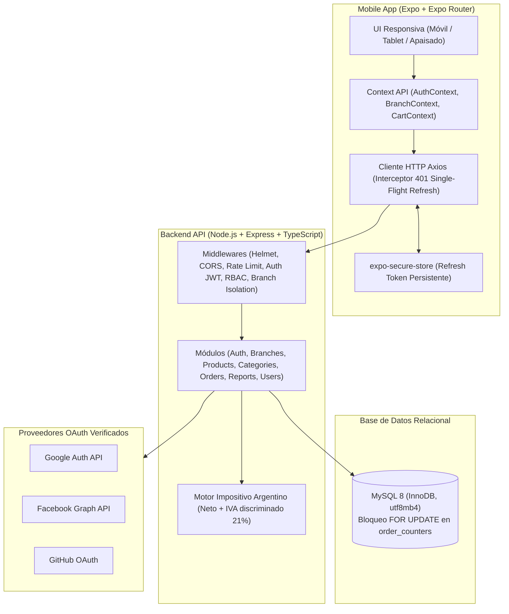

# LateSoft Cafeterías (Argentina)

**LateSoft** es una solución integral y autónoma para la gestión operativa y comercial de una cadena de cafeterías de especialidad en Argentina con múltiples sucursales independientes.

El sistema comprende una **API RESTful modular en Node.js, Express y MySQL 8**, y una **aplicación móvil única en React Native con Expo y Expo Router** cuya interfaz y permisos se adaptan dinámicamente según el rol del usuario autenticado:
- **CUSTOMER (Cliente)**: Selección de sucursal por GPS o escaneo QR, menú con precios locales, pedidos para retirar, seguimiento en vivo cada 5 segundos y gestión de favoritas.
- **CASHIER (Cajero)**: Punto de Venta (POS) en mostrador, cobro con cálculo de vuelto en efectivo, cobro por tarjeta, QR o transferencia, y cobro de pedidos generados desde la app.
- **BARISTA (Barista)**: Pantalla de Comandas (KDS) horizontal siempre encendida, alerta háptica ante pedidos nuevos, avance de estado en un toque y pausa rápida de productos.
- **MANAGER (Encargado)**: Aislamiento estricto de su sucursal, ABML de menú local y precios, alta y baja de cajeros/baristas, cancelación de pedidos con motivo y reportes de facturación.
- **ADMIN (Administrador General)**: Control global de la cadena, ABM de sucursales, categorías y catálogo maestro, creación de encargados y dashboard comparativo entre locales.

---

## 1. Diagrama de Arquitectura



---

## 2. Estructura del Repositorio

```
LATESOFT/
├── ARCHITECTURE.md          # Especificación exhaustiva de arquitectura y datos
├── README.md                # Visión general y guía rápida
├── .gitignore
├── docs/
│   ├── GUIA_INSTALACION.md  # Paso a paso detallado para desarrolladores
│   └── MANUAL_USUARIO.md    # Manual operativo con capturas recomendadas
├── backend/                 # API RESTful en Node.js, Express, TypeScript y Knex
│   ├── knexfile.ts          # Configuración Knex (MySQL en prod/dev, SQLite en test)
│   ├── package.json
│   ├── tsconfig.json
│   ├── README.md            # Documentación completa de endpoints y contratos
│   ├── src/
│   │   ├── app.ts           # Configuración de Express, middlewares y rutas
│   │   ├── server.ts        # Bootstrap del servidor
│   │   ├── config/          # Variables de entorno validadas con Zod
│   │   ├── db/              # Conexión, migraciones y seeds
│   │   ├── middlewares/     # JWT Auth, RBAC, Aislamiento de Sucursal, Rate Limiting
│   │   ├── modules/         # Módulos de dominio (auth, branches, orders, reports, etc.)
│   │   └── utils/           # Cálculos de IVA argentino, criptografía y tokens
│   └── tests/               # Suite de tests Jest + Supertest (RBAC, IDOR, IVA, Auth)
└── mobile/                  # Aplicación móvil Expo Router en TypeScript
    ├── app.json             # Configuración de Expo, permisos en español de Argentina
    ├── eas.json             # Perfiles de build (development, preview APK, production AAB)
    ├── package.json
    ├── tsconfig.json
    ├── app/                 # Rutas de Expo Router (_layout, (auth), (customer), (staff), (admin))
    └── src/
        ├── api/             # Cliente Axios con interceptor single-flight refresh
        ├── context/         # AuthContext, BranchContext, CartContext
        ├── components/      # Button, Input, Card, ErrorBanner, EmptyState, Screen
        └── utils/           # Formateadores es-AR y cálculo de distancia Haversine
```

---

## 3. Puesta en Marcha Rápida

### 3.1 Backend
```bash
cd backend
npm install
cp .env.example .env
# Ajustá tus credenciales de MySQL en .env
npm run db:setup    # Ejecuta migraciones y seeds con datos reales de Argentina
npm test            # Ejecuta la suite completa de 20 tests automáticos
npm run dev         # Inicia el backend en http://localhost:3001
```

### 3.2 Aplicación Móvil (Expo)
```bash
cd mobile
npm install
cp .env.example .env
npx expo start -c   # Inicia Metro bundler
```
*Tip: Dejá habilitado `EXPO_PUBLIC_ENABLE_DEV_SWITCHER=true` para usar el selector flotante inferior que permite alternar entre cualquier rol de prueba con un solo toque.*

---

## 4. Usuarios de Prueba Preconfigurados

Todas las cuentas de prueba de desarrollo comparten la contraseña: `Password123!`. Son solo para desarrollo y tests; nunca ejecutes el seed de demostración en producción.

| Rol | Correo Electrónico | Sucursal Asignada |
| :--- | :--- | :--- |
| **ADMIN** | `admin@latesoft.com.ar` | Acceso global a todas las sucursales |
| **MANAGER** | `manager.palermo@latesoft.com.ar` | Sucursal Palermo Soho (ID 1) |
| **MANAGER** | `manager.belgrano@latesoft.com.ar` | Sucursal Belgrano R (ID 2) |
| **CASHIER** | `cajero.palermo@latesoft.com.ar` | Sucursal Palermo Soho (ID 1) |
| **BARISTA** | `barista.palermo@latesoft.com.ar` | Sucursal Palermo Soho (ID 1) |
| **CUSTOMER** | `cliente@gmail.com` | Cliente frecuente de la app |

---

## 5. Compilación del APK Instalable (EAS Build)

Para compilar el archivo instalable `.apk` para dispositivos Android reales:
```bash
cd mobile
eas build -p android --profile preview
```
El archivo APK resultante se genera listo para descargar e instalar directamente sin requerir publicación en Google Play Store. Consultá la guía completa en `docs/GUIA_INSTALACION.md`.
