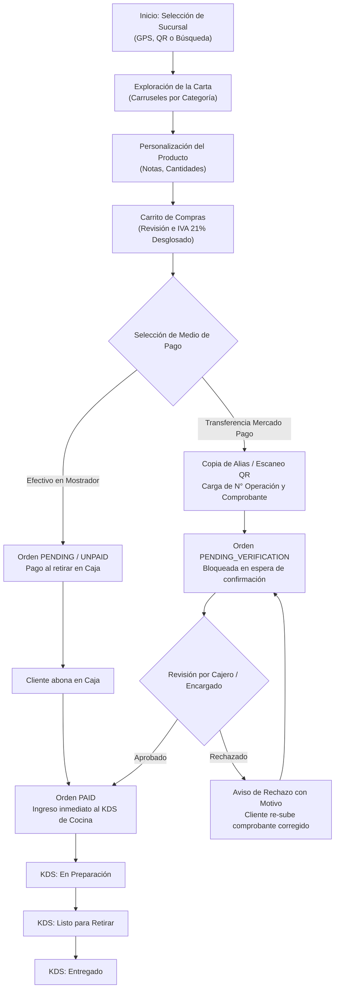

# Manual de Usuario y Guía Operativa de la Plataforma LateSoft: Sistema Multi-Sucursal para Gestión de Cafeterías de Especialidad

---

**Autor:** Francisco Robledo  
**Institución:** Proyecto Tecnológico LateSoft  
**Curso / Contexto:** Desarrollo de Aplicaciones Multiplataforma y Sistemas Distribuidos  
**Fecha:** 30 de Octubre de 2026  
**Formato de Presentación:** Guía Técnica y Manual de Usuario según Normas APA (7.ª Edición)  

---

## Resumen

El presente documento constituye el manual de usuario formal y la guía operativa integral del ecosistema digital **LateSoft**, una solución tecnológica multiplataforma diseñada para optimizar los procesos de comercialización, atención al cliente y despacho operativo en cadenas de cafeterías de especialidad bajo una arquitectura multi-sucursal. Se detallan exhaustivamente las pautas de interacción para los diferentes perfiles del sistema: Clientes (*Customer*), Cajeros (*Cashier*), Baristas (*Barista*), Encargados de Local (*Manager*) y Administradores Generales (*Admin*). La guía aborda desde el proceso de instalación del paquete de distribución Android (.apk) y los mecanismos de autenticación biométrica y federada (Google, Discord, GitHub), hasta los flujos transaccionales avanzados que contemplan la pasarela de pagos con verificación asíncrona de comprobantes mediante Mercado Pago, el sistema de cocina en tiempo real (*Kitchen Display System*), el arqueo de turnos de caja con control de discrepancias y la gestión de permisos delegados con PIN de supervisor (*Manager Override*).

*Palabras clave:* arquitectura multi-sucursal, control de acceso basado en roles (RBAC), punto de venta (POS), sistema de visualización de cocina (KDS), verificación de transferencias, Mercado Pago, React Native, TiDB Cloud.

---

## 1. Introducción y Marco General del Sistema

El crecimiento de la industria gastronómica de especialidad exige plataformas informáticas con alta resiliencia, disponibilidad 24/7 y una experiencia de usuario fluida tanto en dispositivos táctiles móviles como en terminales de punto de venta dedicadas. La plataforma **LateSoft** responde a esta necesidad mediante un modelo desacoplado que integra:

1. **Cliente Móvil y Web (Frontend):** Desarrollado sobre el ecosistema *React Native* con *Expo Framework*, compatible con dispositivos Android, iOS y navegadores web modernos, con soporte estricto de accesibilidad, alto contraste y temas dinámicos (Modo Claro / Modo Oscuro).
2. **Servidor de Aplicaciones (Backend API):** Construido en *Node.js* con *Express* y tipado estricto en *TypeScript*, alojado en la nube de alta disponibilidad de *Render*, respetando una directriz de arquitectura estricta donde todas las comunicaciones operan bajo el protocolo HTTP POST para máxima trazabilidad y seguridad en tránsito.
3. **Persistencia de Datos (Database Layer):** Motor relacional escalable *TiDB Cloud* (compatible con protocolo MySQL 8.0) alojado en la región AWS São Paulo, asegurando transaccionalidad ACID, esquemas normalizados y auditoría inmutable de eventos sensibles.

### 1.1 Objetivo del Manual
El objetivo primordial de esta guía es proporcionar a los usuarios finales y al personal operativo instrucciones paso a paso, precisas y fundamentadas para el aprovechamiento integral de cada una de las funcionalidades de la aplicación, minimizando la curva de aprendizaje y mitigando el margen de error humano en la operación diaria.

---

## 2. Requisitos del Sistema e Instalación de la Aplicación

### 2.1 Requisitos Mínimos de Hardware y Software
Para garantizar un rendimiento óptimo de la aplicación LateSoft, los dispositivos cliente deben cumplir con los siguientes requerimientos:

* **Sistema Operativo:** Android 8.0 (Oreo / API nivel 26) o versiones superiores.
* **Memoria RAM:** Mínimo 2 GB (Recomendado 4 GB o superior).
* **Almacenamiento Interno:** Al menos 50 MB de espacio disponible para la instalación del ejecutable (.apk) y caché de imágenes.
* **Conectividad:** Conexión a red móvil de datos (3G, 4G LTE, 5G) o red local inalámbrica (Wi-Fi) con acceso a Internet.
* **Componentes de Hardware Opcionales pero Recomendados:** Módulo GPS (para auto-detección de sucursal cercana) y sensor de Cámara fotográfica (para lectura de códigos QR en mostrador o mesa).

### 2.2 Procedimiento de Instalación del Paquete APK
1. **Descarga del Instalador:** Acceda desde el navegador web del dispositivo móvil al enlace oficial provisto por el repositorio institucional de Expo EAS:  
   `https://expo.dev/accounts/franguionbajo/projects/latesoft-cafeteria/builds/491668fc-0669-42db-920c-146b236cc7f1`
2. **Habilitación de Orígenes Desconocidos:** Al iniciar la descarga, el sistema operativo Android puede emitir una advertencia de seguridad. Seleccione la opción *Configuración* o *Ajustes* y active la casilla **"Permitir la instalación de aplicaciones desde esta fuente"**.
3. **Ejecución del Asistente:** Presione sobre el archivo `latesoft-cafeteria.apk` descargado y elija el comando **"Instalar"**.
4. **Finalización:** Tras concluir el proceso en pantalla, presione **"Abrir"** para iniciar la aplicación LateSoft.

---

## 3. Módulo de Autenticación y Control de Acceso (RBAC)

La plataforma LateSoft implementa un esquema de **Control de Acceso Basado en Roles** (*Role-Based Access Control*, RBAC) que garantiza la segregación de funciones e impide accesos indebidos o escaladas de privilegios.

### Tabla 1
*Matriz de Roles, Permisos y Credenciales Preconfiguradas para Pruebas*

| Perfil de Usuario | Rol del Sistema | Alcance y Permisos Principales | Correo de Prueba | Contraseña de Acceso |
| :--- | :--- | :--- | :--- | :--- |
| **Cliente** | `CUSTOMER` | Consulta de menú, selección de sucursal, emisión de comandas, pagos MP, acumulación de puntos | `cliente@gmail.com` | `Password123!` |
| **Cajero** | `CASHIER` | Operación de Punto de Venta (POS), cobro de pedidos, verificación de transferencias bancarias | `cajero.palermo@latesoft.com.ar` | `Password123!` |
| **Barista** | `BARISTA` | Visualización del Kitchen Display System (KDS), cambio de estado de preparación, pausa de stock | `barista.palermo@latesoft.com.ar` | `Password123!` |
| **Encargado** | `MANAGER` | Modificación de precios locales, control de catálogo, alta de staff local, anulación de órdenes con PIN | `manager.palermo@latesoft.com.ar` | `Password123!` (PIN: `1234`) |
| **Administrador** | `ADMIN` | Dashboard ejecutivo global, métricas multi-sucursal, auditoría forense general, creación de tiendas | `admin@latesoft.com.ar` | `Password123!` |

*Nota.* Elaboración propia (2026). Todos los usuarios de prueba se encuentran inicializados en la base de datos central de TiDB Cloud.

---

### 3.1 Proceso de Registro de Nuevos Clientes
1. En la pantalla principal de bienvenida, presione el hipervínculo inferior **"¿No tenés una cuenta? Registrate acá"**.
2. Complete los campos requeridos en el formulario de alta:
   * **Nombre y Apellido:** Ingrese su denominación completa (mínimo 2 caracteres).
   * **Correo Electrónico:** Dirección válida donde recibirá las notificaciones transaccionales.
   * **Teléfono de Contacto (Opcional):** Prefijo y número de teléfono celular.
   * **Contraseña:** Clave de seguridad con un estándar mínimo de 8 caracteres alfanuméricos.
   * **Confirmar Contraseña:** Reiteración exacta de la clave elegida para evitar errores de tipeo.
3. Presione el botón **"Crear mi cuenta"**. Al validarse el formulario mediante el motor *Zod*, el usuario será autenticado de forma automática y dirigido a la pantalla principal de compras.

### 3.2 Inicio de Sesión Tradicional
1. En la vista de login, ingrese su correo electrónico registrado y contraseña.
2. Presione **"Ingresar a mi cuenta"**. 
3. El sistema evaluará las credenciales contra la base de datos mediante encriptación criptográfica *bcrypt*. Si la verificación es exitosa, el sistema generará un par de tokens criptográficos (Token de Acceso JWT de corta duración y Token de Renovación persistente en almacenamiento seguro).

### 3.3 Autenticación Federada mediante Redes Sociales
LateSoft ofrece mecanismos de inicio de sesión único (*Single Sign-On*, SSO) mediante proveedores de identidad externos reconocidos:

* **Continuar con Google:** Permite autenticar de manera inmediata al cliente en dispositivos Android con cuenta activa, vinculando el correo electrónico de forma automática sin necesidad de memorizar contraseñas adicionales.
* **Continuar con Discord:** Redirige al protocolo OAuth2 de Discord para autorizar la lectura del perfil básico y correo del usuario.
* **Continuar con GitHub:** Abre la pasarela OAuth de GitHub para validar la identidad de desarrolladores o entusiastas tecnológicos.

> [!IMPORTANT]
> **Regla de Seguridad Innegociable:** La autenticación social está reservada **exclusivamente para cuentas con rol de Cliente (`CUSTOMER`)**. Si un empleado con rol de Cajero, Barista, Encargado o Administrador intenta vincular o acceder mediante una red social, el sistema rechazará la operación por motivos de seguridad institucional, exigiendo el uso de credenciales corporativas directas.

---

## 4. Manual de Operación para el Cliente (Customer Journey)

El entorno para el consumidor final ha sido diseñado priorizando la ergonomía táctil, la rapidez de respuesta y la claridad informativa.

*Figura 1.* Flujo integral de compra, pago por Mercado Pago y ciclo de vida de la comanda en LateSoft.

---

### 4.1 Navegación y Barra de Pestañas Inferior
La interfaz del cliente cuenta con una barra de navegación inferior permanente compuesta por 5 accesos directos principales:
1. **Carta (Ícono Café):** Catálogo de productos interactivo distribuido en carruseles horizontales.
2. **Sucursales (Ícono Ubicación):** Listado y buscador de locales físicos de LateSoft.
3. **Carrito (Ícono Canasta):** Detalle de productos seleccionados, cálculo de impuestos y checkout.
4. **Mis Pedidos (Ícono Recibo):** Módulo de seguimiento en tiempo real del estado de las órdenes.
5. **Mi Perfil (Ícono Usuario):** Información de cuenta, puntos de fidelidad, preferencias de tema visual y cierre de sesión.

---

### 4.2 Selección y Cambio de Sucursal
Debido a que cada sucursal de LateSoft cuenta con su propio inventario, precios diferenciados y promociones exclusivas, el cliente debe seleccionar el local donde retirará su pedido:

1. Ingrese a la pestaña **Sucursales**.
2. **Geolocalización Automática:** Si concedió el permiso de GPS, el sistema ordenará los locales según su proximidad física (calculada en kilómetros exactos mediante la fórmula de Haversine).
3. **Escaneo de Código QR:** Si usted se encuentra presencialmente en una sucursal, toque el botón marrón con el ícono de **Código QR** ubicado junto a la barra de búsqueda. Apunte la cámara hacia el QR del mostrador o mesa; la app detectará la tienda al instante y cargará su menú específico.
4. **Búsqueda Manual o por Código:** Puede utilizar el campo de texto superior para buscar por nombre de barrio (ej. *"Palermo"*, *"Belgrano"*, *"San Telmo"*) o escribir el slug identificador en la casilla de código manual.
5. **Marcado de Favoritos:** Toque el ícono de la **estrella** en cualquier tarjeta de sucursal para guardarla en sus favoritos persistentes.
6. **Selección Activa:** Toque sobre la tarjeta de la sucursal elegida. Verá la insignia destacada **"✓ Sucursal seleccionada"**.

---

### 4.3 Exploración del Menú y Personalización de Productos
1. En la pestaña **Carta**, observará la barra superior con el nombre del local activo y el selector rápido de cambio.
2. **Búsqueda de Ítems:** Utilice la barra de búsqueda interactiva para filtrar cafés, pastelería o bebidas por su nombre.
3. **Navegación por Carruseles:** Cuando no hay una búsqueda activa, los productos se presentan agrupados horizontalmente bajo sus respectivas categorías (*Café de Especialidad*, *Pastelería Artesanal*, *Tostados & Salados*, *Bebidas Frías*).
4. **Detalle y Personalización:** Toque sobre la fotografía o nombre de cualquier producto:
   * Se desplegará una ventana modal con la descripción gourmet del artículo y su precio.
   * **Modificador de Cantidades:** Presione `+` o `-` para indicar el número de unidades.
   * **Notas de Preparación:** Redacte indicaciones especiales para el barista (ej. *"Leche deslactosada, sin cacao espolvoreado, bien caliente"*).
5. Presione **"Agregar al Carrito"**.

---

### 4.4 Checkout y Métodos de Pago
Diríjase a la pestaña **Carrito** para concretar su pedido:

1. **Revisión del Pedido:** Compruebe las cantidades e importes unitarios. Si desea remover un producto, presione el ícono del cesto de basura.
2. **Tipo de Entrega:** Seleccione entre:
   * **Para llevar (Take Away):** El café se preparará en vaso térmico con tapa biodegradable.
   * **Consumir en el local (Dine In):** Se servirá en vajilla de porcelana para disfrutar en mesa.
3. **Desglose Impositivo Oficial:** La aplicación desglosa automáticamente la estructura impositiva argentina:
   $$\text{Subtotal Neto} = \frac{\text{Precio Final}}{1 + \text{IVA}}$$
   $$\text{IVA (21\%)} = \text{Total} - \text{Subtotal Neto}$$
4. **Elección del Medio de Pago:**
   * **Opción A: Pago en Caja (Efectivo / Tarjeta al Retirar):**  
     Seleccione esta opción si prefiere abonar en el mostrador físico de la sucursal al momento de la entrega. Presione **"Confirmar pedido para retirar"**. El pedido quedará emitido en estado `PENDING` (Pendiente de cobro).
   * **Opción B: Transferencia Bancaria Mercado Pago (Alias / QR):**  
     Seleccione esta modalidad para pagar a distancia de manera electrónica:
     1. El sistema desplegará el **Alias CBU/CVU de Mercado Pago** propio de la sucursal seleccionada (ej. `latesoft.palermo.mp`).
     2. Presione el botón **"Copiar"** para transferir el alias a su portapapeles y diríjase a su app de Mercado Pago o banco para transferir el importe exacto. Alternativamente, puede escanear el código QR en pantalla.
     3. Regrese a LateSoft e ingrese obligatoriamente el **Número de Operación de Mercado Pago** (código numérico de 8 a 12 dígitos emitido en el comprobante).
     4. Presione **"Adjuntar comprobante"** y cargue la captura de pantalla o recibo emitido por la entidad bancaria.
     5. Presione **"Confirmar y Enviar Comprobante"**.

---

### 4.5 Seguimiento en Tiempo Real y Estado de Comprobantes
En la pestaña **Mis Pedidos**, el cliente puede monitorear sus órdenes mediante un indicador gráfico (*stepper*) de 4 etapas que se sincroniza automáticamente cada 5 segundos:

* **Paso 1 - Recibido / Verificación:**  
  * Si eligió transferencia Mercado Pago, el pedido exhibirá la leyenda azul:  
    `VERIFICANDO PAGO (MP) • Comprobante enviado`  
    El pedido **no ingresará a la cocina** hasta que el personal de caja constate la acreditación del dinero en la cuenta comercial.
  * Si el cajero detectara un error (ejemplo: importe incompleto o comprobante ilegible) y rechazara el pago, el pedido mostrará un recuadro de alerta con el **motivo de rechazo** y un botón interactivo: **"Volver a subir comprobante"**, permitiéndole corregir la captura o el número de operación sin perder el pedido.
* **Paso 2 - En preparación:**  
  Una vez confirmado el pago, la orden se envía instantáneamente al KDS de los baristas. El indicador se ilumina indicando que el barista está elaborando la comanda.
* **Paso 3 - ¡Listo para retirar!:**  
  La orden se encuentra terminada sobre la barra de entrega de la sucursal lista para el cliente.
* **Paso 4 - Entregado:**  
  El pedido fue despachado satisfactoriamente al cliente.

---

### 4.6 Programa de Fidelidad y Modo Visual
* **LateSoft Rewards (Puntos de Café):** En la pestaña **Mi Perfil**, el cliente acumula puntos por cada compra acreditada. Dichos puntos son canjeables por descuentos y productos promocionales.
* **Tema Visual (Claro / Oscuro):** El cliente puede alternar en todo momento entre el Modo Claro institucional (tonos crema y café tostado) y el Modo Oscuro de alto contraste (superficies oscuras con acentos dorados) mediante el botón flotante con ícono de Luna/Sol o desde la tarjeta de Apariencia en el perfil.

---

## 5. Manual de Operación para el Cajero (Punto de Venta - POS)

El rol de Cajero (`CASHIER`) dispone de herramientas especializadas para la facturación ágil y la validación financiera de cobranzas.

### 5.1 Facturación en Mostrador
1. Inicie sesión con su cuenta asignada a la sucursal correspondiente. La aplicación abrirá automáticamente la terminal de Punto de Venta (**POS**).
2. **Selección de Productos:** Presione sobre los artículos de la grilla izquierda para añadirlos a la venta actual.
3. **Cálculo de Cambio en Efectivo:** Al presionar **"Cobrar en Efectivo"**, ingrese el monto entregado por el cliente en billetes; el sistema calculará al instante el **vuelto exacto**, evitando errores de caja.
4. **Confirmación:** Al registrar el cobro, el sistema emite el número de orden consecutivo diario de la sucursal y la comanda pasa a cocina.

### 5.2 Verificación de Transferencias Mercado Pago
Para validar los pedidos realizados por clientes desde la aplicación móvil mediante transferencia:
1. En la parte superior del POS, seleccione la pestaña **"Transferencias MP"**. Un indicador numérico señalará la cantidad de transferencias que esperan confirmación.
2. Cada tarjeta muestra el número de orden, nombre del cliente, total a cobrar, el **Número de Operación bancario** declarado y una miniatura del comprobante.
3. Presione sobre el comprobante para ampliarlo y verificar los datos contra la terminal bancaria del local.
4. **Acción de Resolución:**
   * **Aprobar Pago:** Si el importe se encuentra acreditado, presione el botón verde **"Aprobar Pago"**. La orden pasará inmediatamente a estado `PAID`, se acreditarán los puntos de fidelidad al cliente y la comanda se transmitirá automáticamente a las pantallas del KDS.
   * **Rechazar Comprobante:** Si el dinero no ingresó o el comprobante es falso/erróneo, presione el botón rojo **"Rechazar"**. El sistema solicitará obligatoriamente un **motivo de rechazo** (ej. *"Importe insuficiente: transfirió $3.000 pero el total es $4.200"*). Dicho motivo se notificará en vivo al cliente en su aplicación.

---

## 6. Manual de Operación para Baristas y Cocina (KDS)

El sistema de visualización de cocina (**Kitchen Display System - KDS**) está optimizado para funcionar en tabletas o monitores montados en la barra de despacho, operando en **modo apaisado u horizontal**.

### 6.1 Gestión de Comandas en Vivo
1. La pantalla se organiza en tres columnas dinámicas de estado:
   * **Pendientes (Naranja):** Comandas con cobro ya confirmado que esperan inicio de elaboración.
   * **En Preparación (Azul):** Pedidos en proceso de molienda, extracción o tostado.
   * **Listos para Retirar (Verde):** Pedidos finalizados listos en el mostrador.
2. **Sincronización Periódica y Respuesta Háptica:** La pantalla se refresca en segundo plano cada 5 segundos. Ante el ingreso de una nueva orden, el dispositivo ejecuta una vibración háptica de alerta.
3. **Avance Rápido de Comandas:** Con un solo toque sobre la tarjeta de comanda:
   * Toque **"Comenzar"** para mover la orden a *En Preparación*.
   * Toque **"Marcar Listo"** para mover la orden a *Listos*.
   * Toque **"Entregar"** para despachar definitivamente al cliente.

### 6.2 Pausa de Productos por Quiebre de Stock
Si en la estación de trabajo se agota un insumo crítico (ejemplo: granos Colombia Huila o medialunas de manteca):
1. En la esquina superior derecha del KDS, presione el botón **"Pausar Producto"**.
2. Seleccione el artículo de la lista y elija la causa de la pausa (ej. *"Agotado por el turno"*, *"Rotura de insumo"*).
3. Presione **"Confirmar Pausa"**. El producto quedará deshabilitado de forma instantánea en la app móvil de todos los clientes para esa sucursal, evitando pedidos de artículos no disponibles. Cuando se reponga el stock, toque **"Reactivar"**.

---

## 7. Manual del Encargado de Sucursal (Manager)

El Encargado (`MANAGER`) supervisa la operatividad del local, vela por la integridad del flujo de fondos y ejerce facultades de supervisor.

### 7.1 Anulación de Pedidos con PIN de Supervisor (Manager Override)
Por normativas de auditoría interna, los cajeros no pueden cancelar pedidos cobrados por cuenta propia. En caso de cancelaciones o errores de facturación:
1. El cajero o encargado solicita la cancelación del pedido.
2. Se desplegará una ventana modal de seguridad exigiendo el **PIN de Supervisor** (código de 4 dígitos configurado para el manager del local).
3. Ingrese el PIN (predeterminado: `1234`) y detalle la causa del descarte de comanda.
4. El sistema auditará la anulación registrando la identidad del supervisor, la fecha, hora exacta y la sucursal en el libro de auditoría de TiDB.

### 7.2 Apertura y Arqueo de Turnos de Caja (Cash Shifts)
1. Al inicio de cada turno operativo, el encargado ingresa a la pestaña **Turnos** y realiza la **Apertura de Caja** declarando el fondo de cambio inicial en efectivo.
2. Al finalizar la jornada, procede al **Cierre y Arqueo de Caja**:
   * El sistema calcula de forma ciega el efectivo teórico que debería haber según las ventas del día.
   * El encargado cuenta los billetes físicos e ingresa el monto real contado.
   * El sistema registra automáticamente la **diferencia de caja** (sobrante o faltante) y emite el resumen consolidado del turno.

---

## 8. Manual del Administrador Central (Executive Dashboard)

El perfil con rol de Administrador (`ADMIN`) tiene visibilidad omnicanal y facultades de configuración global sobre toda la cadena LateSoft:

1. **Dashboard Ejecutivo:** Gráficos comparativos de facturación mensual, ticket promedio y volumen de transacciones desglosado por cada una de las sucursales (*Palermo*, *Belgrano*, *San Telmo*).
2. **Ranking de Productos:** Listado analítico de los ítems más vendidos y márgenes de rendimiento.
3. **Registro de Auditoría Forense (`/audit`):** Consulta inmutable de todas las acciones críticas ejecutadas en el sistema (cambios de precios fuera de límites, overrides con PIN, bajas de personal, modificaciones de roles).
4. **Gestión de Catálogo y Sucursales:** Habilitación de nuevas tiendas físicas, configuración de coordenadas geográficas, horarios de apertura y porcentajes tributarios de IVA.

---

## 9. Resolución de Incidencias Frecuentes (FAQ)

### 9.1 ¿Qué hacer si la aplicación indica "Sucursal no encontrada" o error 404 al abrir el menú?
La aplicación cuenta con rutinas automáticas de autorrecuperación (*self-healing*). Si los identificadores del servidor se hubieran actualizado, diríjase a la pestaña **Sucursales**, seleccione manualmente cualquiera de las sucursales de la lista (*Palermo*, *Belgrano* o *San Telmo*) y el sistema sincronizará la carta vigente al instante.

### 9.2 ¿Qué ocurre si un cliente pierde la conexión a Internet durante un pedido?
El cliente cuenta con interceptores de red y avisos visuales de desconexión (*Offline Banner*). Si se pierde la conectividad, las transacciones pendientes no se duplicarán gracias al sistema de tokens idempotentes implementado en el backend.

### 9.3 ¿Cómo actuar si un comprobante de Mercado Pago no coincide con el total?
El cajero debe presionar el botón **"Rechazar"** e indicar el saldo faltante en el campo de texto explicativo. El cliente recibirá inmediatamente la instrucción en su pantalla de *Mis Pedidos* y podrá re-subir el comprobante complementario sin reiniciar la comanda.

---

## 10. Referencias

American Psychological Association. (2020). *Publication manual of the American Psychological Association* (7th ed.). https://doi.org/10.1037/0000165-000

Expo Documentation Team. (2026). *EAS Build: Building standalone Android applications with APK profiles*. Expo Documentation. https://docs.expo.dev/build-reference/apk/

Fielding, R. T. (2000). *Architectural styles and the design of network-based software architectures* (Doctoral dissertation). University of California, Irvine.

Node.js Foundation. (2026). *Node.js design patterns and enterprise RESTful architectures*. OpenJS Foundation.

PingCAP. (2026). *TiDB Cloud architecture documentation: Serverless MySQL compatibility and ACID compliance*. PingCAP Docs. https://docs.pingcap.com/tidbcloud/

React Native Core Team. (2026). *React Native architecture and cross-platform mobile user interfaces*. Meta Platforms & Open Source Community. https://reactnative.dev/docs/architecture-overview
